Estudiante de Ingeniería de Sistemas e Informática en la Universidad Nacional de Colombia, sede Medellín.
Me interesan el desarrollo backend, la ingeniería de datos y la ciberseguridad.

## `01` Desarrollo backend

| Proyecto | Qué hace | Stack | Ver |
|:---|:---|:---|:---|
| **api-cuentas** | API REST para crear cuentas y transferir saldo entre ellas dentro de una transacción, con pruebas | `Java` `Spring Boot` `Spring Data JPA` `PostgreSQL` | [Código](https://github.com/Danieldlr13/api-cuentas) |
| **Platia** | Consolida gastos a partir de los correos de notificación de Bancolombia y los muestra en un panel, con pruebas y CI | `TypeScript` `Next.js` `Supabase` | [Código](https://github.com/Danieldlr13/Platia) |
| **AutogestionComfaChoco** | Sistema de gestión de vacaciones y permisos, desarrollado en equipo | `Laravel` `MySQL` | [Código](https://github.com/Camilotabares/AutogestionComfaChoco) |
| **DPlay** | Reproductor de música web | `Aplicación web` | [Demo](https://reproductor-dandel.web.app/) · repo privado |

## `02` Datos

| Proyecto | Qué hace | Stack | Ver |
|:---|:---|:---|:---|
| **Analítica descriptiva** | Actividades del curso: limpieza, anonimización y análisis de datos | `Python` `pandas` `SQLite` | [Código](https://github.com/2026-2-descriptiva/std-daniel-steven-de-la-rosa-narvaez) |
| **Analítica predictiva** | Actividades del curso: regresión, clasificación, clustering, series de tiempo y pipelines | `Python` `scikit-learn` | [Código](https://github.com/2026-2-predictiva/std-daniel-steven-de-la-rosa-narvaez) |
| **Solicitudes de crédito** | Laboratorio de limpieza de datos | `Python` `pandas` | [Código](https://github.com/2025-2-fundamentos/LAB-06-limpieza-de-datos-de-solicitudes-de-credito-Danieldlr13) |
| **Predicción de default** | Laboratorio de clasificación con regresión logística | `Python` | [Código](https://github.com/2025-2-fundamentos/LAB-10-prediccion-del-default-usando-logreg-Danieldlr13) |

## `03` Seguridad e infraestructura

| Proyecto | Qué hace | Stack | Ver |
|:---|:---|:---|:---|
| **Hackathon Aligo, Defensores Informáticos** (Talento Tech) | Framework de comando y control para laboratorio autorizado, con protocolo binario propio y cifrado autenticado | `Python` `X25519` `ChaCha20-Poly1305` | Repo privado |
| **repeat-me** | Convierte un dispositivo Linux en un punto de acceso WiFi con un solo comando | `Shell` `hostapd` `dnsmasq` | [Código](https://github.com/Danieldlr13/repeat-me) |

## Tecnologías

| Área | Herramientas |
|:---|:---|
| **Lenguajes** | `Python` `Java` `TypeScript` `JavaScript` `SQL` |
| **Frameworks** | `Spring Boot` `Node.js` `Next.js` `FastAPI` `Laravel` |
| **Datos** | `PostgreSQL` `MySQL` `pandas` |
| **Herramientas** | `Docker` `GitHub Actions` `Linux` |

## Contacto

[LinkedIn](https://www.linkedin.com/in/daniel-steven-de-la-rosa-narvaez-a54368303/) · dandel@unal.edu.co
